import MLTests from '/snippets/ml-inventory-tests.mdx';

The ML layer's tests are load-bearing, not box-ticking. The leakage spine is the only thing standing between a model that looks good on paper and one that silently inflates every offline number by memorising the season. The ONNX parity gate is the only thing that ensures the browser scores what the Python booster trained. Every test has a unique idea; none is decorative.

<CodeGroup>

```bash Run all ML tests
make ml-test
```

```bash Run a specific group
./.venv/bin/python -m pytest ml/tests/test_features.py -v          # leakage spine
./.venv/bin/python -m pytest ml/tests/test_onnx_parity.py -v       # ONNX parity
./.venv/bin/python -m pytest ml/tests/test_predict.py -v           # predict schema
./.venv/bin/python -m pytest ml/tests/test_evaluate.py -v          # evaluation gates
./.venv/bin/python -m pytest ml/tests/test_crps.py -v              # CRPS
./.venv/bin/python -m pytest ml/tests/test_targets.py -v           # targets
./.venv/bin/python -m pytest ml/tests/test_survival.py -v          # survival / AFT
./.venv/bin/python -m pytest ml/tests/test_manifest_contract.py -v # version contract
./.venv/bin/python -m pytest ml/tests/test_ceiling.py -v           # attainable ceilings
./.venv/bin/python -m pytest ml/tests/test_attribution.py -v       # within-stint attribution
./.venv/bin/python -m pytest ml/tests/test_fit_parity.py -v        # fit parity
./.venv/bin/python -m pytest ml/tests/test_search_space.py -v      # search space
./.venv/bin/python -m pytest ml/tests/test_powerlaw_export.py -v   # power-law tyre curve
```

</CodeGroup>

## The tests, grouped

The table is generated from the live pytest collection, so its counts are always current.

```mermaid
graph LR
    subgraph IN["What goes in"]
        G1["Leakage Spine"]
        G2["Targets"]
    end
    subgraph FIT["How it is fit"]
        G3["Fit Parity"]
        G4["Search Space"]
        G5["Survival / AFT"]
    end
    subgraph SCORE["Whether it is good"]
        G6["Evaluation Gates"]
        G7["CRPS"]
        G8["Attainable Ceilings"]
        G9["Within-stint Attribution"]
    end
    subgraph SHIP["What ships"]
        G10["ONNX Parity"]
        G11["Predict Schema"]
        G12["Version Contract"]
        G13["Power-law Tyre Curve"]
    end
    IN --> FIT --> SCORE --> SHIP
```

<MLTests />



## Go deeper

<CardGroup cols={2}>
  <Card title="Leakage Spine" href="/ml/ci/leakage-spine" icon="shield">
    The leakage guards in detail one idea each, with the assertion and why it matters.
  </Card>
  <Card title="Parity & Schema" href="/ml/ci/parity-and-schema" icon="check-check">
    The ONNX parity, predict-schema, target and version-contract tests: the mechanical contracts.
  </Card>
  <Card title="Evaluation Gates" href="/ml/ci/evaluation-gates" icon="trophy">
    Beats-baseline, calibration computed, cohorts surfaced, ceilings and intervals.
  </Card>
  <Card title="Version Contract" href="/ml/ci/parity-and-schema#version-contract-30-tests" icon="tag">
    The checks that the manifest names the version it shipped, declares the input width each booster actually takes, and matches the copy the browser loads.
  </Card>
  <Card title="Validation" href="/ml/validation" icon="chart-bar">
    The methodology behind the metrics these gates enforce.
  </Card>
</CardGroup>
