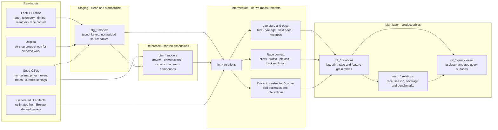
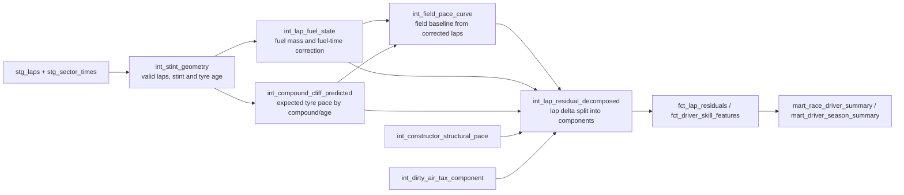
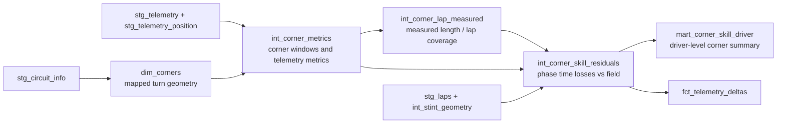
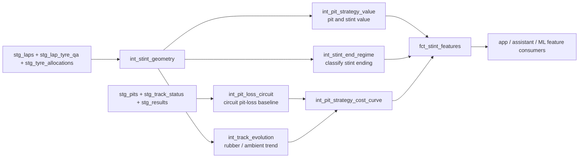
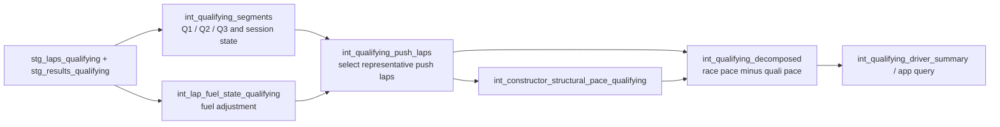

This page explains the warehouse at two levels: the model layers, then the main calculation chains. Bronze is the primary raw racing-data source. The other boxes below are supporting inputs, not equivalent raw-data feeds. Each box names the resulting dbt relation. The [model reference](/reference/models) has the full per-model list and descriptions.

## Warehouse DAG

Arrows show the broad flow; the actual DAG is finer grained, and many models have multiple parents. In dbt SQL, `ref('model_name')` is the dependency edge. `source(...)` reads raw Bronze or the limited Jolpica pit-stop feed. Seed CSVs are small support tables: some are manual identity/event mappings, while others contain curated settings or calibration results. Fit parquet files are generated by separate fitting steps from panels built from Bronze data, then loaded into dbt as inputs; they are not a separate raw racing-data provider. For example, constructor fixed effects are fit from the clean lap panel, and the degradation fit is produced from historical tyre observations. The model flow here abstracts those fit-generation steps, so its arrows start at the fit artifact.

## What each layer does

| Layer | Typical input | Work done | Result |
|---|---|---|---|
| Staging (`stg_*`) | Raw parquet rows and event feeds | Cast types, build stable IDs, normalize timestamps and codes, retain source-grain records, and derive basic validity or QA flags. | Consistent source-shaped tables such as one row per lap, pit stop, telemetry sample, or control message. |
| Reference (`dim_*`) | Staging, seeds, curated mappings | Resolve driver/team/circuit identities; map corners and compounds to stable IDs and season context. | Reusable dimensions for joins and labels. |
| Intermediate (`int_*`) | Staging, dimensions, other intermediate results, and sometimes fitted parameters | Add race/lap/stint state; calculate physical or statistical features; estimate baselines and residuals; attach uncertainty and availability flags. | Calculation-ready relations at explicit grains such as lap, stint, race, driver-season, or corner-lap. |
| Facts (`fct_*`) | Intermediate measurements and dimensions | Select and assemble model features at a consumer-facing grain; preserve keys, units, and explanatory fields. | Stable analytical tables used by app pages, exports, and ML. |
| Marts (`mart_*`) and query views (`qv_*`) | Facts, intermediate results, dimensions | Aggregate to race/season/driver summaries, coverage, benchmarks, and app/assistant query shapes. | Published summaries or purpose-built query relations. |

## Main calculation chains

### Race lap pace and driver residual

`int_stint_geometry` adds stint boundaries, lap-in-stint, tyre age, compound and lap eligibility. `int_lap_fuel_state` estimates fuel load and converts it to a lap-time penalty. The compound model supplies expected tyre pace. `int_field_pace_curve` estimates a smoothed field baseline from corrected laps. The residual model then compares actual lap time with that baseline and accounts for fuel, compound, constructor pace and dirty-air terms; the remaining driver residual is in seconds, with positive values meaning slower. NULLs and flags carry unavailable or low-sample cases through the chain. The resulting fact tables support driver, race, and season summaries.

### Telemetry and corner skill

Telemetry samples are mapped to corner windows, then reduced to braking point, minimum speed, throttle point, and related measures. The measured corner length converts speed differences into time differences. Trailing field medians provide a comparison baseline; braking, mid-corner, and exit terms are signed as seconds lost (positive) or gained (negative). The mart aggregates those corner-lap results to driver/corner summaries.

### Stints, tyre degradation, and pit strategy

The stint model assigns tyre age and compound, classifies how a stint ended, and joins track conditions. Track evolution estimates within-session surface trends; pit-loss models estimate the time cost of a stop; strategy models combine stop cost and stint pace/value. `fct_stint_features` collects these at stint grain, including measured sample counts and unavailable-reason fields where applicable.

### Qualifying

Qualifying laps are separated by segment and filtered to representative push laps. Fuel and constructor effects are accounted for before producing comparable qualifying pace and the race-versus-qualifying delta. The current delta convention is race pace minus qualifying pace; check the individual model reference for sign details and caveats.

## Reading the resulting tables

- `int_*` tables are calculation steps; their names describe intermediate concepts, not necessarily user-facing metrics.
- `fct_*` tables usually keep a detailed grain for analysis or feature use. Read the model description for the key and unit.
- `mart_*` tables aggregate facts into product-level summaries. `qv_*` views adapt relations for queries and assistant tools.
- Fitted inputs are not always calculated in dbt. For example, a fit source can be produced by Python and then passed through an `int_*` model.
- This is a conceptual map, not a claim that every model has been empirically validated. Model-level details and current audit status are in the [dbt model reference](/reference/models) and the project's transform status board.
