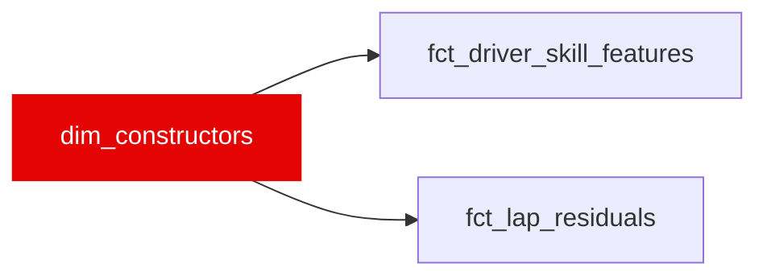

{/* _AUTOGENERATED   do not hand-edit. Run `python scripts/gen_dbt_reference.py` to regenerate. */}

<Note>Part of the [Reference](/transform/families/reference) family.</Note>

One row per constructor (team) name, from a fixed list in the model rather than from the loaded laps (CO-29), so every build, the CI fixture included, has every team. pu_family is one family per team name (not per season); it is a reference attribute carried onto fct_lap_residuals and fct_driver_skill_features, and no pace index or model reads it. A team rename arrives as a new constructor_id and needs its own row; a name missing from the list fails the stg_laps.constructor_id relationships test. constructor_lineage_id groups the names one team has raced under (a rename is the same team, owner's ruling 2026-10-23).

## Lineage

## Overview

| Property | Value |
|---|---|
| Layer | `reference` |
| Family | [Reference](/transform/families/reference) |
| Contract enforced | No |

**27 tests** [guard](/transform/ci/overview) this model  -  26 generic, 1 singular.

## Columns

| Column | Type | Nullable | Tests | Description |
|---|---|---|---|---|
| `constructor_id` | `varchar` | Yes | [`not_null`](/transform/ci/structural), [`unique`](/transform/ci/structural) | Team name as reported by FastF1 (e.g. 'Mercedes', 'Red Bull Racing'). |
| `pu_family` | `varchar` | Yes | [`not_null`](/transform/ci/structural) | Power-unit family grouping (e.g. mercedes_pu, honda_pu, ferrari_pu, renault_pu). |
| `constructor_lineage_id` | `varchar` | Yes | [`not_null`](/transform/ci/structural) | The team across its renames: the snake-cased earliest name it has in the data. force_india (Force India, Racing Point, Aston Martin), toro_rosso (Toro Rosso, AlphaTauri, RB, Racing Bulls), sauber (Sauber, Alfa Romeo Racing, Alfa Romeo, Kick Sauber), renault (Renault, Alpine); every other team is its own lineage. |
