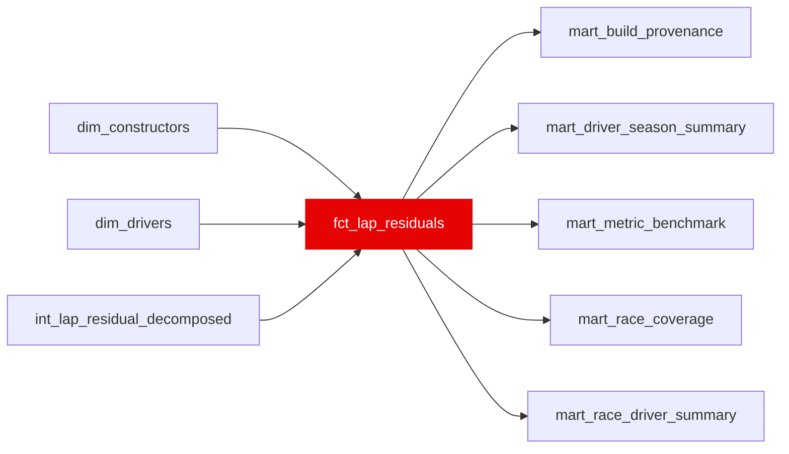

{/* _AUTOGENERATED   do not hand-edit. Run `python scripts/gen_dbt_reference.py` to regenerate. */}

<Note>Part of the [Marts](/transform/families/marts) family.</Note>

> For the conceptual foundation, read [Fct Lap Residuals](/decomposition/additive-identity).

Lap-grain analytics table. One row per valid race lap. Exposes the full residual decomposition from int_lap_residual_decomposed plus anomaly flags from int_lap_anomaly_flags. Use ml_eligible = TRUE to filter to training-quality laps. For ML model inputs, prefer the split marts:
  - fct_driver_skill_features   race-grain skill aggregates
  - fct_cliff_prediction_features   lap-grain with next_lap_degradation_jump_s target

## Lineage

## Overview

| Property | Value |
|---|---|
| Layer | `marts` |
| Family | [Marts](/transform/families/marts) |
| Contract enforced | No |
| Upstream | [`int_lap_residual_decomposed`](../int/int_lap_residual_decomposed), [`dim_drivers`](../dim/dim_drivers), [`dim_constructors`](../dim/dim_constructors) |

**34 tests** [guard](/transform/ci/overview) this model  -  22 generic, 12 singular.

## Columns

| Column | Type | Nullable | Tests | Description |
|---|---|---|---|---|
| `lap_id` | `varchar` | Yes | [`not_null`](/transform/ci/structural), [`unique`](/transform/ci/structural) | Surrogate PK, FK to stg_laps. |
| `race_year` | `integer` | Yes | [`not_null`](/transform/ci/structural) | Season year. |
| `race_id` | `varchar` | Yes | [`not_null`](/transform/ci/structural), `relationships` | Race identifier. |
| `driver_id` | `varchar` | Yes | [`not_null`](/transform/ci/structural), `relationships` | Driver identifier. |
| `constructor_id` | `varchar` | Yes | [`not_null`](/transform/ci/structural), `relationships` | Constructor identifier. |
| `lap_number` | `integer` | Yes | [`not_null`](/transform/ci/structural) | Lap number within the race. |
| `lap_time_s` | `double` | Yes | [`not_null`](/transform/ci/structural) | Raw lap time in seconds. |
| `compound` | `varchar` | Yes | [`accepted_values`](/transform/ci/range-and-domain), `relationships` | Tyre compound on this lap. |
| `fuel_component_s` | `double` | Yes | [`not_null`](/transform/ci/structural) | Fuel-burnoff weight penalty component. |
| `compound_component_s` | `double` | Yes | [`not_null`](/transform/ci/structural) | Tyre-compound degradation component. NULL when the compound or the tyre age is unknown: stints stg_lap_tyre_qa quarantines have both NULLed, and a few laps have a compound but no age in bronze. Until the F39 fix those laps carried the 10 s wear cap here instead (DuckDB's LEAST skips the NULL age), and this test, scoped only on compound, passed on the fabricated value. |
| `rubber_component_s` | `double` | Yes |   | Track-rubber evolution component. NULL where int_track_evolution has no row for the lap (TX-30 step e; was 0.0). Informational, outside the residual identity. |
| `ambient_component_s` | `double` | Yes |   | Ambient/weather component. NULL under the same condition as rubber_component_s (TX-30 step e; was 0.0). |
| `constructor_component_s` | `double` | Yes | [`not_null`](/transform/ci/structural) | Constructor structural pace component. 0.0 where constructor_pace_is_filled. |
| `constructor_pace_is_filled` | `boolean` | Yes | [`not_null`](/transform/ci/structural), [`accepted_values`](/transform/ci/range-and-domain) | TRUE where constructor_component_s is the 0.0 fill (no measured structural pace for the race and constructor). Aggregates of the car term leave these laps out. Does not enter ml_eligible. |
| `dirty_air_tax_s` | `double` | Yes | [`not_null`](/transform/ci/structural) | Per-lap dirty-air slowdown component. NULL on a lap with a measured base whose previous lap's air state is unmeasured (FD6 / CO-04); driver_skill_residual_s is NULL there too. |
| `dirty_air_tax_se_s` | `double` | Yes |   | Convention, not an estimate: 0.15 × the tax. Zero on clean-air laps. Not propagated from θ's interval. Do not quote as a standard error. (TX-04; same text as int_dirty_air_tax_component.dirty_air_tax_se_s.) |
| `driver_skill_residual_s` | `double` | Yes | [`not_null`](/transform/ci/structural) | Residual after fuel/compound/constructor/dirty-air (driver skill). WI-01/F1: NULL, not a fabricated number, when base_track_pace_s, compound_component_s or dirty_air_tax_s is itself unmeasured -- see pace_delta_s. |
| `base_track_pace_s` | `double` | Yes |   | Field pace baseline (int_field_pace_curve), fuel- and compound-neutral. NULL when the field curve has no measured row for this (race, lap_number) (F1) -- not COALESCEd to a fabricated value. |
| `pace_delta_s` | `double` | Yes |   | lap_time_s - base_track_pace_s. NULL when base_track_pace_s is NULL (F1). |
| `base_pace_status` | `varchar` | Yes |   | Why base_track_pace_s is or is not there, from int_lap_residual_decomposed: MEASURED (a pace cell on 5 or more cars), THIN_CELL (a cell on fewer than 5 cars, no base) or NO_CELL (no pace cell for the lap). base_track_pace_s and pace_delta_s are NULL exactly when this is not MEASURED. total_explained_s is numeric regardless, so it is not a measured decomposition on non-MEASURED rows. |
| `base_eligible_lap_count` | `integer` | Yes |   | Count (laps, unitless) of eligible laps behind the lap's pace cell. NULL only when base_pace_status is NO_CELL. |
| `ml_eligible` | `boolean` | Yes | [`not_null`](/transform/ci/structural) | TRUE when the lap is training-quality for ML inputs. |
| `correction_weight` | `double` | Yes | [`not_null`](/transform/ci/structural) | IPW/cleanliness weight for the lap. |
