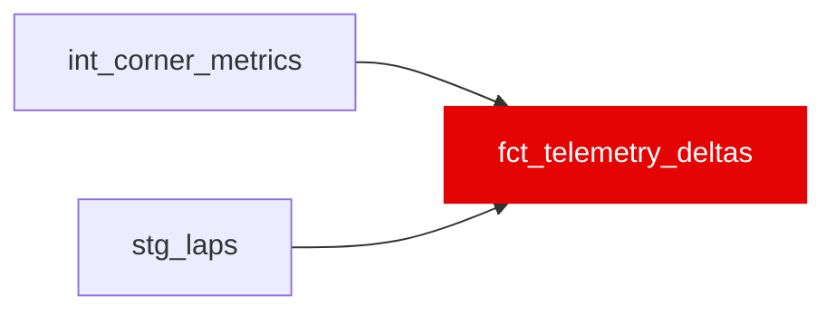

{/* _AUTOGENERATED   do not hand-edit. Run `python scripts/gen_dbt_reference.py` to regenerate. */}

<Note>Part of the [Marts](/transform/families/marts) family.</Note>

Driver-vs-teammate corner-metric deltas. Grain: one row per (race_id, driver_a, driver_b, corner_name, lap_number) for each teammate pair (same constructor_id in that race, driver_a &lt; driver_b), the per-corner difference in braking point, minimum corner speed, and throttle-application point. Built by FULL OUTER joining the two teammates' int_corner_metrics on corner and lap, so a corner either driver measured has a row; a delta is NULL where either side is missing, never 0 (CO-22; before it, every driver in the race was paired with every other and unmatched corners were written as 0). Exported to the app's data bundle but has no current app feature consumer.

## Lineage

## Overview

| Property | Value |
|---|---|
| Layer | `marts` |
| Family | [Marts](/transform/families/marts) |
| Contract enforced | No |
| Upstream | [`int_corner_metrics`](../int/int_corner_metrics), [`stg_laps`](../stg/stg_laps) |
| Model-level tests | `unique_combination_of_columns` |

**10 tests** [guard](/transform/ci/overview) this model  -  8 generic, 2 singular.

## Columns

| Column | Type | Nullable | Tests | Description |
|---|---|---|---|---|
| `race_id` |   | Yes | [`not_null`](/transform/ci/structural), `relationships` | Race identifier. |
| `driver_a` |   | Yes | [`not_null`](/transform/ci/structural) | First driver of the teammate pair (lexicographically smaller id). |
| `driver_b` |   | Yes | [`not_null`](/transform/ci/structural) | Second driver of the teammate pair. |
| `corner_name` |   | Yes | [`not_null`](/transform/ci/structural) | Named track corner the delta is measured at. |
| `track_id` |   | Yes | [`not_null`](/transform/ci/structural) | Track identifier for the corner. |
| `lap_number` |   | Yes | [`not_null`](/transform/ci/structural) | Lap number within the race. |
| `braking_point_delta_m` |   | Yes |   | driver_a − driver_b braking point (metres). Positive = driver_a brakes later. NULL when either side is missing or has no braking point (corner taken flat); never 0-filled (CO-22, assert_telemetry_deltas_null_when_side_missing). |
| `v_min_delta_kph` |   | Yes |   | driver_a − driver_b minimum corner speed (kph). Positive = driver_a carries more speed. NULL when either side is missing; never 0-filled (CO-22). |
| `throttle_point_delta_m` |   | Yes |   | driver_a − driver_b throttle-application point (metres). Positive = driver_a gets on power later. NULL when either side is missing or never reaches full throttle; never 0-filled (CO-22). |
