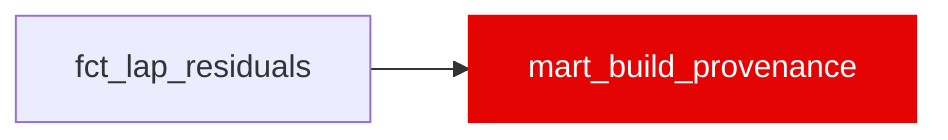

{/* _AUTOGENERATED   do not hand-edit. Run `python scripts/gen_dbt_reference.py` to regenerate. */}

<Note>Part of the [Marts](/transform/families/marts) family.</Note>

Exactly one row per build: the transform label version, the dirty-air coefficient and method, the regulation-era and holdout settings, the data window, and the dbt run that built this warehouse. One provenance table instead of a column on every mart. The app export copies this row into _manifest.json as the top-level `provenance` object and adds git_sha / git_dirty there (dbt cannot read git). Pinned to dbt_project.yml by assert_build_provenance_one_row_matches_vars.

## Lineage

## Overview

| Property | Value |
|---|---|
| Layer | `marts` |
| Family | [Marts](/transform/families/marts) |
| Contract enforced | No |
| Upstream | [`fct_lap_residuals`](./fct_lap_residuals) |

**16 tests** [guard](/transform/ci/overview) this model  -  15 generic, 1 singular.

## Columns

| Column | Type | Nullable | Tests | Description |
|---|---|---|---|---|
| `label_version` |   | Yes | [`not_null`](/transform/ci/structural), [`accepted_values`](/transform/ci/range-and-domain) | Transform label version (var label_version). v16 per D11 (v16 = transform label, v17 = ML model); sealed by CO-33. A label bump edits the var. |
| `label_sealed_on` |   | Yes | [`not_null`](/transform/ci/structural) | Date the label version was sealed (var label_sealed_on). |
| `theta_air_label_value` |   | Yes | [`not_null`](/transform/ci/structural) | θ_air, the dirty-air coefficient in s/lap applied by int_dirty_air_tax_component (var theta_air_label_value). Declared, fitted outside dbt. |
| `theta_air_fit_season_max` |   | Yes | [`not_null`](/transform/ci/structural) | Last season in θ_air's calibration population (var theta_air_fit_season_max). |
| `dirty_air_method` |   | Yes | [`not_null`](/transform/ci/structural) | Method tag for every dirty-air number (var dirty_air_method, TX-04): flat θ × lagged dirty-air share, not validated. |
| `era_boundary` |   | Yes | [`not_null`](/transform/ci/structural) | First season of the current regulation era (var era_boundary). |
| `holdout_season` |   | Yes | [`not_null`](/transform/ci/structural) | Season held out of estimation (var holdout_season). |
| `data_season_min` |   | Yes | [`not_null`](/transform/ci/structural) | First season in fct_lap_residuals. |
| `data_season_max` |   | Yes | [`not_null`](/transform/ci/structural) | Last season in fct_lap_residuals. |
| `n_races` |   | Yes | [`not_null`](/transform/ci/structural) | Distinct races with at least one lap in fct_lap_residuals. |
| `n_races_scheduled` |   | Yes | [`not_null`](/transform/ci/structural) | Distinct races in race_to_track. Can exceed n_races: a race with no racing laps (2021_12) is scheduled but has no lap rows. |
| `model_version` |   | Yes |   | No promoted ML model yet (XM); named v17 per D11 / HD8 when promoted. NULL until then. |
| `dbt_invocation_id` |   | Yes | [`not_null`](/transform/ci/structural) | dbt invocation_id of the build. Changes every build; excluded from the byte oracle. |
| `built_at` |   | Yes | [`not_null`](/transform/ci/structural) | dbt run_started_at of the build, as a timestamp with time zone (the export writes it as ISO 8601 with offset). Changes every build; excluded from the byte oracle. |
| `dbt_version` |   | Yes | [`not_null`](/transform/ci/structural) | dbt-core version that built the warehouse. |
