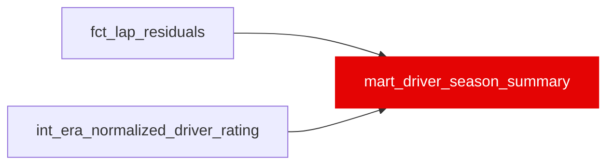

{/* _AUTOGENERATED   do not hand-edit. Run `python scripts/gen_dbt_reference.py` to regenerate. */}

<Note>Part of the [Marts](/transform/families/marts) family.</Note>

One row per driver-season, shaped for plain-language explanations ("22nd of 22"). Grain: (driver_id, race_year). rating_s is int_era_normalized_driver_rating's era_adjusted_rating (shrunk teammate-relative gap, seconds; negative = faster), ranked within the season by that gap (teammate_gap_rank 1 = most negative; not a field-speed rank). The primary constructor is the one the driver ran the most clean laps for; the teammate is the other driver with the most clean laps for that constructor. Component means are over ml_eligible laps of fct_lap_residuals (seconds, positive = slower).

## Lineage

## Overview

| Property | Value |
|---|---|
| Layer | `marts` |
| Family | [Marts](/transform/families/marts) |
| Contract enforced | No |
| Upstream | [`fct_lap_residuals`](./fct_lap_residuals), [`int_era_normalized_driver_rating`](../int/int_era_normalized_driver_rating) |
| Model-level tests | `unique_combination_of_columns` |

**15 tests** [guard](/transform/ci/overview) this model  -  14 generic, 1 singular.

## Columns

| Column | Type | Nullable | Tests | Description |
|---|---|---|---|---|
| `driver_id` |   | Yes | [`not_null`](/transform/ci/structural), `relationships` | FastF1 three-letter driver code (e.g. VER, HAM). |
| `race_year` |   | Yes | [`not_null`](/transform/ci/structural) | Season year. |
| `rating_s` |   | Yes | [`not_null`](/transform/ci/structural) | Season rating (era_adjusted_rating), seconds. Negative = faster than teammate(s). |
| `teammate_gap_rank` |   | Yes | [`not_null`](/transform/ci/structural), [`accepted_range`](/transform/ci/range-and-domain) | Rank of rating_s (the gap to one's own teammate) within the season; 1 = furthest ahead of his teammate. Not a ranking of driver speed against the field: a driver in a weak car can rank high and one in a strong car can rank low. Ties share a rank. |
| `n_drivers` |   | Yes | [`not_null`](/transform/ci/structural), [`accepted_range`](/transform/ci/range-and-domain) | Number of rated drivers that season. |
| `teammate_gap_percentile` |   | Yes | [`accepted_range`](/transform/ci/range-and-domain) | 1 - (teammate_gap_rank - 1) / (n_drivers - 1). 1.0 = largest lead over his own teammate in the season, 0.0 = largest deficit. Not a field-speed percentile. |
| `ci_low` |   | Yes |   | Lower bound of the 95% CI on rating_s (era_adjusted_rating_ci_low_s). |
| `ci_high` |   | Yes |   | Upper bound of the 95% CI on rating_s (era_adjusted_rating_ci_high_s). |
| `n_races` |   | Yes | [`not_null`](/transform/ci/structural), [`accepted_range`](/transform/ci/range-and-domain) | Races behind the season rating. |
| `teammate_id` |   | Yes |   | Primary-constructor teammate with the most clean laps. Null when there is none. |
| `teammate_gap_s` |   | Yes |   | Equal to rating_s, which already is the season-average gap to his teammate(s), pooled over every teammate he raced (teammate_id is only the one with the most clean laps). Seconds, negative = faster than the teammate. NULL when teammate_id is NULL. |
| `constructor_id` |   | Yes | [`not_null`](/transform/ci/structural), `relationships` | Primary constructor for the season (most clean laps). |
| `constructor_rank` |   | Yes |   | Season rank of the constructor's mean constructor_component_s; 1 = fastest car. |
| `mean_fuel_component_s` |   | Yes |   | Mean fuel component over ml_eligible laps, seconds. |
| `mean_compound_component_s` |   | Yes |   | Mean compound component over ml_eligible laps, seconds. |
| `mean_constructor_component_s` |   | Yes |   | Mean constructor component over ml_eligible laps, seconds. |
| `mean_dirty_air_tax_s` |   | Yes |   | Mean dirty-air tax over ml_eligible laps, seconds. |
