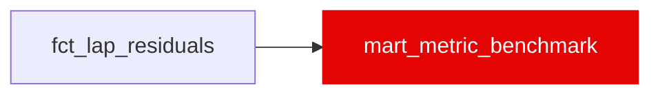

{/* _AUTOGENERATED   do not hand-edit. Run `python scripts/gen_dbt_reference.py` to regenerate. */}

<Note>Part of the [Marts](/transform/families/marts) family.</Note>

Per-metric distribution by season over clean (ml_eligible) laps of fct_lap_residuals, so an explanation can say what is typical for a value. Grain: (metric_name, race_year). Covers driver_skill_residual_s, fuel_component_s, compound_component_s, constructor_component_s, dirty_air_tax_s and lap_time_s. Null values are dropped before aggregation.

## Lineage

## Overview

| Property | Value |
|---|---|
| Layer | `marts` |
| Family | [Marts](/transform/families/marts) |
| Contract enforced | No |
| Upstream | [`fct_lap_residuals`](./fct_lap_residuals) |
| Model-level tests | `unique_combination_of_columns` |

**10 tests** [guard](/transform/ci/overview) this model  -  10 generic, 0 singular.

## Columns

| Column | Type | Nullable | Tests | Description |
|---|---|---|---|---|
| `metric_name` |   | Yes | [`not_null`](/transform/ci/structural), [`accepted_values`](/transform/ci/range-and-domain) | Source column in fct_lap_residuals. |
| `race_year` |   | Yes | [`not_null`](/transform/ci/structural) | Season year. |
| `p05` |   | Yes |   | 5th percentile (QUANTILE_CONT). |
| `p50` |   | Yes | [`not_null`](/transform/ci/structural) | Median (QUANTILE_CONT). |
| `p95` |   | Yes |   | 95th percentile (QUANTILE_CONT). |
| `mean` |   | Yes | [`not_null`](/transform/ci/structural) | Arithmetic mean. |
| `sd` |   | Yes |   | Sample standard deviation. |
| `unit` |   | Yes | [`not_null`](/transform/ci/structural), [`accepted_values`](/transform/ci/range-and-domain) | Unit of every value in the row. Always 's' (seconds). |
| `sample_size` |   | Yes | [`not_null`](/transform/ci/structural), [`accepted_range`](/transform/ci/range-and-domain) | Non-null lap count behind the row. |
