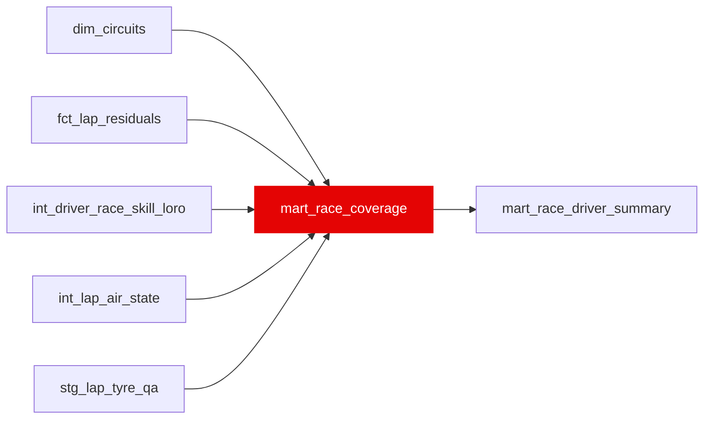

{/* _AUTOGENERATED   do not hand-edit. Run `python scripts/gen_dbt_reference.py` to regenerate. */}

<Note>Part of the [Marts](/transform/families/marts) family.</Note>

One row per race_to_track race: what the warehouse measured for it and, when a race has no rating or thin residuals, why (coverage_reason). Every value is derived from the data, never from a hand list of race ids. On the 2018-2025 build: 173 races in race_to_track, 172 in fct_lap_residuals (2021_12 has no racing laps), 171 rated (2021_16 is all wet, so the rating's clean panel has no dry pairs).

## Lineage

## Overview

| Property | Value |
|---|---|
| Layer | `marts` |
| Family | [Marts](/transform/families/marts) |
| Contract enforced | No |
| Upstream | [`fct_lap_residuals`](./fct_lap_residuals), [`int_lap_air_state`](../int/int_lap_air_state), [`stg_lap_tyre_qa`](../stg/stg_lap_tyre_qa), [`int_driver_race_skill_loro`](../int/int_driver_race_skill_loro), [`dim_circuits`](../dim/dim_circuits) |

**14 tests** [guard](/transform/ci/overview) this model  -  13 generic, 1 singular.

## Columns

| Column | Type | Nullable | Tests | Description |
|---|---|---|---|---|
| `race_id` |   | Yes | [`unique`](/transform/ci/structural), [`not_null`](/transform/ci/structural) | Race identifier (race_to_track). |
| `race_year` |   | Yes | [`not_null`](/transform/ci/structural) | Season year, from race_id. |
| `circuit_id` |   | Yes |   | Physical circuit identifier from dim_circuits. |
| `n_lap_rows` |   | Yes | [`not_null`](/transform/ci/structural), [`accepted_range`](/transform/ci/range-and-domain) | Laps in fct_lap_residuals for the race. 0 when it has none. |
| `n_ml_eligible_laps` |   | Yes | [`not_null`](/transform/ci/structural), [`accepted_range`](/transform/ci/range-and-domain) | ml_eligible laps in fct_lap_residuals. 0 when none. |
| `base_measured_share` |   | Yes |   | Share of the race's fct_lap_residuals laps with a base_track_pace_s. NULL when n_lap_rows = 0. |
| `residual_measured_share` |   | Yes |   | Share of the race's fct_lap_residuals laps with a driver_skill_residual_s. NULL when n_lap_rows = 0. |
| `rain_lap_share` |   | Yes |   | Share of the race's fct_lap_residuals laps with rainfall_flag. NULL when n_lap_rows = 0. |
| `air_measured_share` |   | Yes |   | Share of the race's int_lap_air_state laps with a measured air state (air_state_dominant not NULL). |
| `bronze_tyre_life_share` |   | Yes |   | Share of the race's stg_lap_tyre_qa laps with a bronze TyreLife. Below 0.90 (the bronze_checks MIN_LAP_KEY_SHARE) the load is thin. |
| `tyre_qa_status` |   | Yes | [`accepted_values`](/transform/ci/range-and-domain) | 'quarantined_race' when stg_lap_tyre_qa quarantines the whole race, 'partial' when it quarantines any driver-race, 'ok' otherwise. NULL when the race has no stg_lap_tyre_qa rows. |
| `has_telemetry` |   | Yes | [`not_null`](/transform/ci/structural) | air_measured_share &gt; var('isolation_thin_min_air_measured_share') (0.5). FALSE on the races bronze has no per-lap telemetry for (KNOWN_TELEMETRY_GAPS: 2018_1, 2018_2). |
| `n_rated_drivers` |   | Yes | [`not_null`](/transform/ci/structural) | Drivers with a race rating (rows mart_race_driver_summary keeps). 0 when none. |
| `has_rating` |   | Yes | [`not_null`](/transform/ci/structural) | TRUE when at least one driver in the race has a race rating. |
| `coverage_reason` |   | Yes | [`not_null`](/transform/ci/structural), [`accepted_values`](/transform/ci/range-and-domain) | Why coverage is short, first match wins: NO_RACING_LAPS (no fct_lap_residuals rows), ALL_WET_NO_DRY_PAIRS (no rating and rain_lap_share &gt; 0.5), NO_TELEMETRY (has_telemetry FALSE), TYRE_QA_QUARANTINED (tyre_qa_status = 'quarantined_race'), TYRE_LIFE_PARTIAL (bronze_tyre_life_share &lt; 0.90), OK. |
