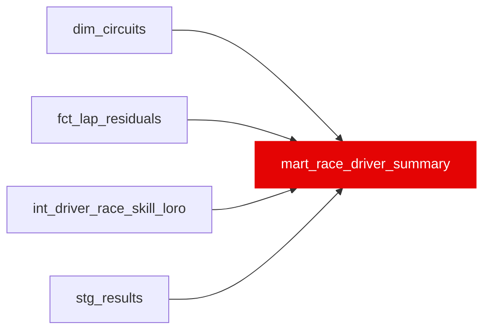

{/* _AUTOGENERATED   do not hand-edit. Run `python scripts/gen_dbt_reference.py` to regenerate. */}

<Note>Part of the [Marts](/transform/families/marts) family.</Note>

One row per driver-race, shaped for plain-language explanations ("why so slow at Monza"). Grain: (driver_id, race_id). rating_s is int_driver_race_skill_loro's driver_skill_loro_s (median lap-by-lap gap to the teammate; negative = faster). There is no within-race rank: ordering every driver's gap to his own teammate across the field reads as a speed ranking and is not one (CO-01/T4), so it was dropped. ci_low / ci_high are rating_s +/- 1.96 x the standard error of clean-lap driver_skill_residual_s: a lap-noise band, not the season Bayesian CI. Component means are over ml_eligible laps (seconds, positive = slower).

## Lineage

## Overview

| Property | Value |
|---|---|
| Layer | `marts` |
| Family | [Marts](/transform/families/marts) |
| Contract enforced | No |
| Upstream | [`fct_lap_residuals`](./fct_lap_residuals), [`stg_results`](../stg/stg_results), [`int_driver_race_skill_loro`](../int/int_driver_race_skill_loro), [`dim_circuits`](../dim/dim_circuits) |
| Model-level tests | `unique_combination_of_columns` |

**17 tests** [guard](/transform/ci/overview) this model  -  15 generic, 2 singular.

## Columns

| Column | Type | Nullable | Tests | Description |
|---|---|---|---|---|
| `driver_id` |   | Yes | [`not_null`](/transform/ci/structural), `relationships` | FastF1 three-letter driver code (e.g. VER, HAM). |
| `race_id` |   | Yes | [`not_null`](/transform/ci/structural), `relationships` | Race identifier. |
| `race_year` |   | Yes | [`not_null`](/transform/ci/structural) | Season year. |
| `circuit_id` |   | Yes | `relationships` | Physical circuit identifier from dim_circuits. |
| `rating_s` |   | Yes | [`not_null`](/transform/ci/structural) | Race rating (driver_skill_loro_s), seconds. Negative = faster than the teammate. |
| `n_drivers` |   | Yes | [`not_null`](/transform/ci/structural), [`accepted_range`](/transform/ci/range-and-domain) | Number of rated drivers in the race. |
| `ci_low` |   | Yes |   | rating_s - 1.96 x standard error of clean-lap driver_skill_residual_s. |
| `ci_high` |   | Yes |   | rating_s + 1.96 x standard error of clean-lap driver_skill_residual_s. |
| `n_clean_laps` |   | Yes | [`accepted_range`](/transform/ci/range-and-domain) | ml_eligible laps behind the components and the CI band. |
| `teammate_id` |   | Yes |   | Same-race teammate with the most clean laps. Null when there is none. |
| `teammate_gap_s` |   | Yes |   | Equal to rating_s, which already is the paired median gap to the teammate, so the two teammates' values are exact negatives. Seconds, negative = faster than the teammate. NULL when teammate_id is NULL. |
| `constructor_id` |   | Yes | [`not_null`](/transform/ci/structural), `relationships` | Constructor for the race. |
| `constructor_rank` |   | Yes |   | Race rank of the constructor's mean constructor_component_s; 1 = fastest car. |
| `mean_fuel_component_s` |   | Yes |   | Mean fuel component over ml_eligible laps, seconds. |
| `mean_compound_component_s` |   | Yes |   | Mean compound component over ml_eligible laps, seconds. |
| `mean_constructor_component_s` |   | Yes |   | Mean constructor component over ml_eligible laps, seconds. |
| `mean_dirty_air_tax_s` |   | Yes |   | Mean dirty-air tax over ml_eligible laps, seconds. |
| `avg_lap_time_s` |   | Yes |   | Mean lap time over ml_eligible laps, seconds. |
| `laps_completed` |   | Yes | [`accepted_range`](/transform/ci/range-and-domain) | All laps the driver has in fct_lap_residuals for the race, clean or not. |
| `positions_gained` |   | Yes |   | grid_position - finish_position from stg_results. Positive = places gained. NULL when grid_position = 0 (pit-lane start, not a grid slot) or either position is missing. |
| `has_dnf` |   | Yes | [`not_null`](/transform/ci/structural) | TRUE when stg_results marks the driver as a DNF. FALSE when no result row exists. |
