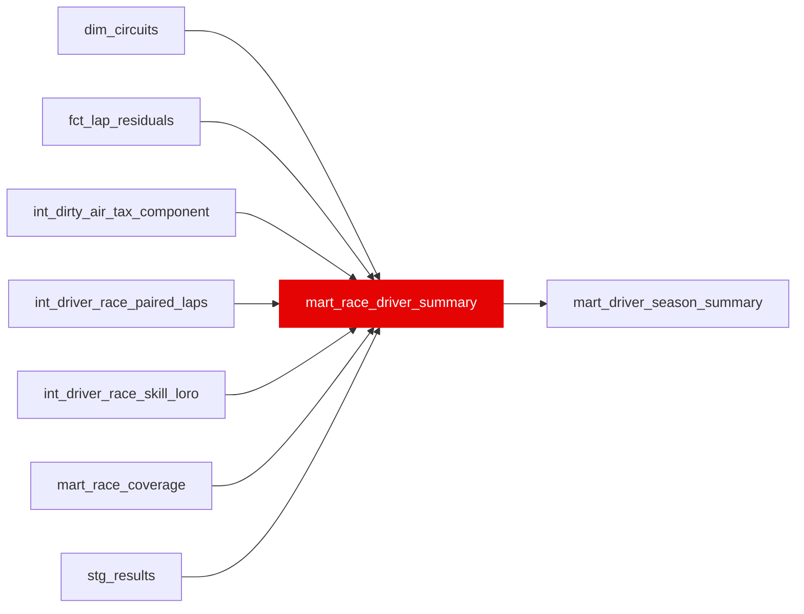

{/* _AUTOGENERATED   do not hand-edit. Run `python scripts/gen_dbt_reference.py` to regenerate. */}

<Note>Part of the [Marts](/transform/families/marts) family.</Note>

One row per driver-race, shaped for plain-language explanations ("why so slow at Monza"). Grain: (driver_id, race_id). rating_s is int_driver_race_skill_loro's driver_skill_loro_s (median lap-by-lap gap to the teammate; negative = faster). There is no within-race rank: ordering every driver's gap to his own teammate across the field reads as a speed ranking and is not one (CO-01/T4), so it was dropped. ci_low / ci_high (TX-01) are a distribution-free 95% CI for that median, built from the same paired lap gaps (int_driver_race_paired_laps): the order statistics [x_j, x_&#123;n-j+1&#125;] of the n = paired_lap_count sorted gaps, where j is the largest k with P(Bin(n, 1/2) &lt;= k - 1) &lt;= 0.025 (coverage &gt;= 95%). NULL when n &lt; 6, where no such interval exists. Not the season Bayesian CI. rating_trust_label says how far to trust rating_s: suppressed (n &lt; 6), thin (6 &lt;= n &lt; 12), ok (n &gt;= 12). Component means are over ml_eligible laps (seconds, positive = slower).

## Lineage

## Overview

| Property | Value |
|---|---|
| Layer | `marts` |
| Family | [Marts](/transform/families/marts) |
| Contract enforced | No |
| Upstream | [`fct_lap_residuals`](./fct_lap_residuals), [`int_dirty_air_tax_component`](../int/int_dirty_air_tax_component), [`stg_results`](../stg/stg_results), [`int_driver_race_paired_laps`](../int/int_driver_race_paired_laps), [`int_driver_race_skill_loro`](../int/int_driver_race_skill_loro), [`dim_circuits`](../dim/dim_circuits), [`mart_race_coverage`](./mart_race_coverage) |
| Model-level tests | `unique_combination_of_columns` |

**32 tests** [guard](/transform/ci/overview) this model  -  25 generic, 7 singular.

## Columns

| Column | Type | Nullable | Tests | Description |
|---|---|---|---|---|
| `driver_id` |   | Yes | [`not_null`](/transform/ci/structural), `relationships` | FastF1 three-letter driver code (e.g. VER, HAM). |
| `race_id` |   | Yes | [`not_null`](/transform/ci/structural), `relationships` | Race identifier. |
| `race_year` |   | Yes | [`not_null`](/transform/ci/structural) | Season year. |
| `circuit_id` |   | Yes | `relationships` | Physical circuit identifier from dim_circuits. |
| `rating_s` |   | Yes | [`not_null`](/transform/ci/structural) | Race rating (driver_skill_loro_s), seconds. Negative = faster than the teammate. |
| `n_drivers` |   | Yes | [`not_null`](/transform/ci/structural), [`accepted_range`](/transform/ci/range-and-domain) | Number of rated drivers in the race (rows of this mart for the race; assert_ai_mart_counts_consistent). At least 2: the rating is a paired gap to a same-car teammate. |
| `ci_low` |   | Yes |   | Lower bound of a distribution-free 95% CI for the median paired gap (rating_s): x_j, the j-th smallest of the paired_lap_count paired gaps, with j the largest k such that P(Bin(n, 1/2) &lt;= k - 1) &lt;= 0.025. Seconds. NULL when paired_lap_count &lt; 6. Not symmetric about rating_s. |
| `ci_high` |   | Yes |   | Upper bound of the same CI: x_&#123;n-j+1&#125;, the j-th largest paired gap. Seconds. NULL when paired_lap_count &lt; 6. For a two-driver car it is minus the teammate's ci_low. |
| `n_clean_laps` |   | Yes | [`accepted_range`](/transform/ci/range-and-domain) | ml_eligible laps behind the component means. Not the sample behind rating_s or its CI (that is paired_lap_count). NULL, never 0, when the driver has none (residual_unavailable_reason says why; assert_reason_iff_missing). |
| `teammate_id` |   | Yes |   | Same-race teammate with the most clean laps. Null when there is none. |
| `teammate_gap_s` |   | Yes |   | Equal to rating_s, which already is the paired median gap to the teammate, so the two teammates' values are exact negatives. Seconds, negative = faster than the teammate. NULL when teammate_id is NULL. |
| `constructor_id` |   | Yes | [`not_null`](/transform/ci/structural), `relationships` | Constructor for the race. |
| `constructor_rank` |   | Yes |   | Race rank of the constructor's mean constructor_component_s; 1 = fastest car. |
| `mean_fuel_component_s` |   | Yes |   | Mean fuel component over ml_eligible laps, seconds. |
| `mean_compound_component_s` |   | Yes |   | Mean compound component over ml_eligible laps, seconds. |
| `mean_constructor_component_s` |   | Yes |   | Mean constructor component over ml_eligible laps, seconds. |
| `mean_dirty_air_tax_s` |   | Yes |   | Mean dirty-air tax over the driver's ml_eligible laps in the race with a measured air state (a row in int_dirty_air_tax_component with a non-NULL tax), seconds. NULL when none (dirty_air_unavailable_reason). fct_lap_residuals' 0.0 on unmeasured laps is excluded. |
| `avg_lap_time_s` |   | Yes |   | Mean lap time over ml_eligible laps, seconds. |
| `laps_completed` |   | Yes | [`not_null`](/transform/ci/structural), [`accepted_range`](/transform/ci/range-and-domain) | All laps the driver has in fct_lap_residuals for the race, clean or not. A rated driver has laps, so never NULL and at least 1 (recounted by assert_ai_mart_counts_consistent). |
| `positions_gained` |   | Yes |   | grid_position - finish_position from stg_results. Positive = places gained. NULL when grid_position = 0 (pit-lane start, not a grid slot) or either position is missing. |
| `has_dnf` |   | Yes | [`not_null`](/transform/ci/structural) | TRUE when stg_results marks the driver as a DNF. FALSE when no result row exists. |
| `paired_lap_count` |   | Yes | [`not_null`](/transform/ci/structural), [`accepted_range`](/transform/ci/range-and-domain) | Laps paired with a same-car teammate's clean lap on the same lap number: the n behind rating_s (their median) and its CI. Equals int_driver_race_skill_loro.paired_lap_count. |
| `rating_trust_label` |   | Yes | [`not_null`](/transform/ci/structural), [`accepted_values`](/transform/ci/range-and-domain) | How far to trust rating_s, from paired_lap_count: 'suppressed' when n &lt; 6 (too few paired laps for a 95% distribution-free CI; ci_low / ci_high NULL), 'thin' when 6 &lt;= n &lt; 12, 'ok' when n &gt;= 12. |
| `ci_unavailable_reason` |   | Yes | [`accepted_values`](/transform/ci/range-and-domain) | Why ci_low / ci_high are NULL: PAIRED_N_BELOW_MIN (paired_lap_count &lt; 6, no 95% distribution-free CI exists). NULL when the CI is present. |
| `residual_unavailable_reason` |   | Yes | [`accepted_values`](/transform/ci/range-and-domain) | Why n_clean_laps and the component means are NULL (the driver has no ml_eligible laps): NO_TELEMETRY (race has_telemetry FALSE in mart_race_coverage), TYRE_QA_QUARANTINED (race tyre_qa_status = 'quarantined_race'), else NO_ML_ELIGIBLE_LAPS. NULL when n_clean_laps is present. |
| `n_dirty_air_measured_laps` |   | Yes | [`not_null`](/transform/ci/structural), [`accepted_range`](/transform/ci/range-and-domain) | ml_eligible laps behind mean_dirty_air_tax_s (measured dirty-air tax). 0 when none. A driver can have clean laps (n_clean_laps) with no measured dirty air. |
| `dirty_air_unavailable_reason` |   | Yes | [`accepted_values`](/transform/ci/range-and-domain) | NO_MEASURED_LAPS when mean_dirty_air_tax_s is NULL; NULL otherwise. Separate from residual_unavailable_reason, which is about n_clean_laps. |
