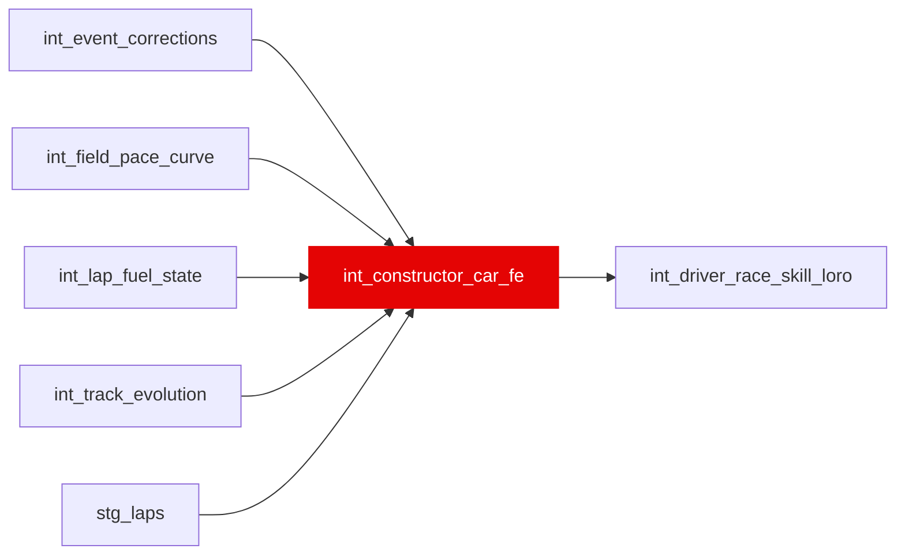

{/* _AUTOGENERATED   do not hand-edit. Run `python scripts/gen_dbt_reference.py` to regenerate. */}

<Note>Part of the [Skill](/transform/families/skill) family.</Note>

De-biased constructor car pace (constructor×race fixed effect), one row per (race_year, race_id, constructor_id). Fitted in-warehouse on every build (models/intermediate/int_constructor_car_fe.py, which reuses fit_car_fe from tasks/coefficients/fit_constructor_car_fe.py) via a two-way FE regression (pace_delta_s ~ 1 | driver_id + constructor_race) on the clean lap panel. car_fe_s estimates car pace net of driver skill (global driver anchor), so subtracting it removes the car without crediting a weak driver's slowness as skill. Consumed only by int_driver_race_skill_loro.driver_skill_field_s → int_driver_circuit_era_affinity (Ghost Car Standings). Negative = faster than field.

## Lineage

## Overview

| Property | Value |
|---|---|
| Layer | `intermediate` |
| Family | [Skill](/transform/families/skill) |
| Contract enforced | No |
| Tags | `causal_decomposition`, `constructor` |
| Upstream | [`int_lap_fuel_state`](./int_lap_fuel_state), [`int_field_pace_curve`](./int_field_pace_curve), [`stg_laps`](../stg/stg_laps), [`int_event_corrections`](./int_event_corrections), [`int_track_evolution`](./int_track_evolution) |

**8 tests** [guard](/transform/ci/overview) this model  -  8 generic, 0 singular.

## Columns

| Column | Type | Nullable | Tests | Description |
|---|---|---|---|---|
| `constructor_car_fe_id` |   | Yes | [`not_null`](/transform/ci/structural), [`unique`](/transform/ci/structural) | Surrogate PK = race_year_raceid_constructorid |
| `race_year` |   | Yes | [`not_null`](/transform/ci/structural) | Season year |
| `race_id` |   | Yes | [`not_null`](/transform/ci/structural), `relationships` | Race identifier (matches int_lap_fuel_state.race_id, e.g. 2018_5) |
| `constructor_id` |   | Yes | [`not_null`](/transform/ci/structural), `relationships` | Constructor identifier (stg_laps.constructor_id) |
| `car_fe_s` |   | Yes | [`not_null`](/transform/ci/structural) | Constructor×race fixed effect in seconds, net of driver skill. Negative = faster than field. |
