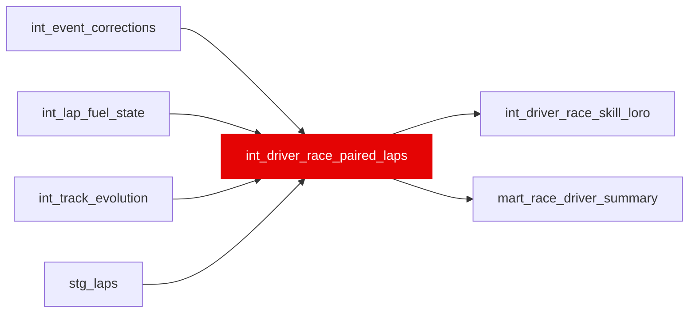

{/* _AUTOGENERATED   do not hand-edit. Run `python scripts/gen_dbt_reference.py` to regenerate. */}

<Note>Part of the [Skill](/transform/families/skill) family.</Note>

The paired lap-time gaps behind the race rating. Grain: (race_id, driver_id, lap_number, teammate_id). paired_delta_s = own lap_time_s - the same-car teammate's lap_time_s on the same lap number, over laps both drivers ran clean (lap time present, correction_weight = 1, no rainfall on the lap: the same clean filter as int_driver_race_skill_loro). int_driver_race_skill_loro.driver_skill_loro_s is the median of these rows and paired_lap_count their count, per (race_id, driver_id); mart_race_driver_summary builds the order-statistic CI for that median from them. For a two-driver car the teammate's rows are the driver's with the sign flipped.

## Lineage

## Overview

| Property | Value |
|---|---|
| Layer | `intermediate` |
| Family | [Skill](/transform/families/skill) |
| Contract enforced | No |
| Tags | `driver_rating`, `causal_decomposition` |
| Upstream | [`int_lap_fuel_state`](./int_lap_fuel_state), [`stg_laps`](../stg/stg_laps), [`int_event_corrections`](./int_event_corrections), [`int_track_evolution`](./int_track_evolution) |
| Model-level tests | `unique_combination_of_columns` |

**9 tests** [guard](/transform/ci/overview) this model  -  8 generic, 1 singular.

## Columns

| Column | Type | Nullable | Tests | Description |
|---|---|---|---|---|
| `race_year` |   | Yes | [`not_null`](/transform/ci/structural) | Season year. |
| `race_id` |   | Yes | [`not_null`](/transform/ci/structural) | Race identifier. |
| `constructor_id` |   | Yes | [`not_null`](/transform/ci/structural) | Constructor of the car both drivers drove. |
| `driver_id` |   | Yes | [`not_null`](/transform/ci/structural) | The driver whose gap this is. |
| `teammate_id` |   | Yes | [`not_null`](/transform/ci/structural) | The same-car teammate the lap is paired with. |
| `lap_number` |   | Yes | [`not_null`](/transform/ci/structural) | Lap number both drivers ran clean. |
| `paired_delta_s` |   | Yes | [`not_null`](/transform/ci/structural) | Own lap time minus the teammate's on the same lap, seconds. Negative = faster. |
