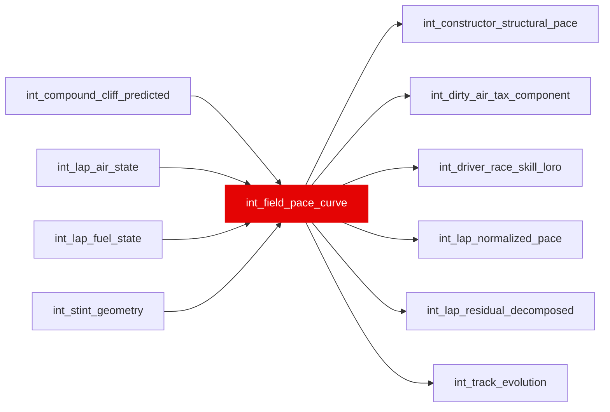

{/* _AUTOGENERATED   do not hand-edit. Run `python scripts/gen_dbt_reference.py` to regenerate. */}

<Note>Part of the [Pace Baselines](/transform/families/pace-baselines) family.</Note>

Field-level baseline pace curve. Grain is (race_year, race_id, lap_number). A 10% trimmed mean of fuel- and compound-corrected clean-air lap times at each lap number, smoothed with a 5-cell centred rolling mean, to establish a baseline uncontaminated by individual driver skill or traffic. CO-04: the smoother stays inside one green segment (it does not cross an SC, VSC or red flag); the first two green laps after an SC or red flag take their own trimmed mean; a cell built on fewer than 5 cars has no base and feeds no neighbour. Only laps known to be in clean air enter (an unmeasured air state, FD6, does not), so 2018_1 Australia and 2018_2 Bahrain, which have no telemetry in bronze, are EXCLUDED FROM THE FIELD BASE: every cell there is thin, no lap has a base, and both races lose their residuals and training labels for that reason (owner decision 2026-10-15).

## Lineage

## Overview

| Property | Value |
|---|---|
| Layer | `intermediate` |
| Family | [Pace Baselines](/transform/families/pace-baselines) |
| Contract enforced | No |
| Upstream | [`int_lap_fuel_state`](./int_lap_fuel_state), [`int_stint_geometry`](./int_stint_geometry), [`int_lap_air_state`](./int_lap_air_state), [`int_compound_cliff_predicted`](./int_compound_cliff_predicted) |

**14 tests** [guard](/transform/ci/overview) this model  -  6 generic, 8 singular.

## Columns

| Column | Type | Nullable | Tests | Description |
|---|---|---|---|---|
| `race_year` |   | Yes | [`not_null`](/transform/ci/structural) | Race year |
| `race_id` |   | Yes | [`not_null`](/transform/ci/structural) | Race identifier |
| `lap_number` |   | Yes | [`not_null`](/transform/ci/structural) | Lap number within race |
| `field_pace_smoothed_s` |   | Yes |   | The field base, seconds. NULL when low_sample_flag is set (W44), and so on every lap of 2018_1 and 2018_2 (FD6). Equal to field_pace_trimmed_mean_s on a neutralised or restart-adjacent cell; otherwise the mean of the non-thin trimmed means from smoothing_window_first_lap to smoothing_window_last_lap. |
| `low_sample_flag` |   | Yes | [`not_null`](/transform/ci/structural) | TRUE when fewer than 5 eligible laps built the cell. Such a cell has no base. |
| `is_neutralised_lap` |   | Yes | [`not_null`](/transform/ci/structural) | TRUE when any driver's lap at this lap number carries an SC, VSC or red flag (int_stint_geometry). Neutralised lap numbers split the smoother into green segments (W43), and a neutralised cell averages only itself. |
| `is_restart_adjacent_lap` |   | Yes | [`not_null`](/transform/ci/structural) | TRUE on the first two green lap numbers after an SC or red-flag lap (not a VSC). Such a cell's base is its own trimmed mean and it is in no other cell's window, because the restart laps run slower than the green laps after them (-1.04 s and -0.49 s of smoothing bias before CO-04 gave them their own mean). Asserted by assert_field_pace_restart_cells_own_mean. |
| `smoothing_window_first_lap` |   | Yes |   | Lap number of the first cell averaged into field_pace_smoothed_s; NULL when the base is NULL. With smoothing_window_last_lap it makes the W43/W44 rules checkable from the output (assert_field_pace_smoothing_respects_boundaries). |
| `smoothing_window_last_lap` |   | Yes |   | Lap number of the last cell averaged into field_pace_smoothed_s; NULL when the base is NULL. |
