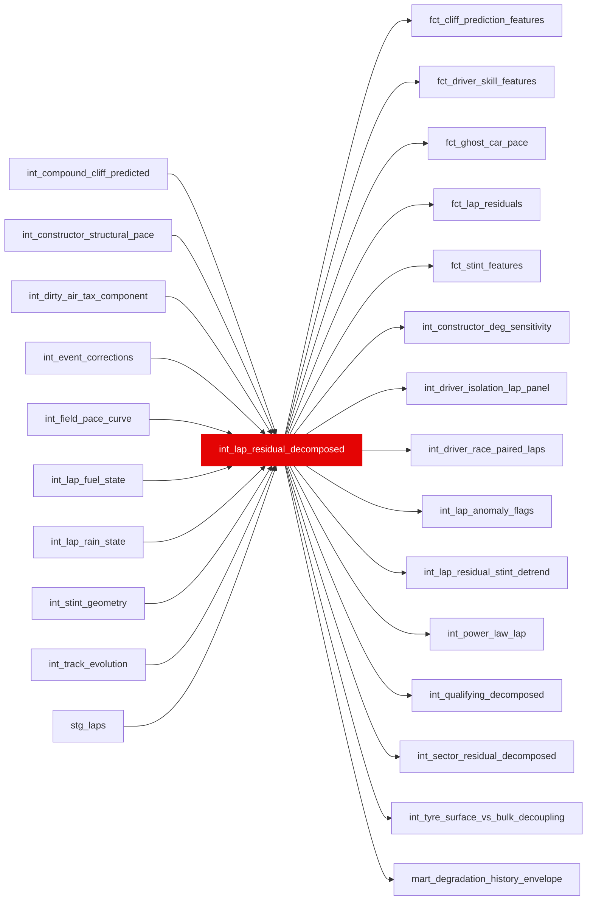

{/* _AUTOGENERATED   do not hand-edit. Run `python scripts/gen_dbt_reference.py` to regenerate. */}

<Note>Part of the [Residual](/transform/families/residual) family.</Note>

> For the conceptual foundation, read [Int Lap Residual Decomposed](/decomposition/additive-identity).

One row per lap. WI-01 (2026-09-27, Option A): base_track_pace_s is fuel- AND compound-neutral and already contains rubber/ambient (int_track_evolution decomposes that same base), so this model's identity is 5-term, not 7: pace_delta_s = fuel_component_s + compound_component_s + constructor_component_s + dirty_air_tax_s + driver_skill_residual_s. rubber_component_s and ambient_component_s are carried as informational columns only (F22 -- subtracting them again on top of the base would double-count them). Driver skill residual = what remains after removing fuel/compound/car/dirty-air. driver_skill_residual_s is NULL (not a fabricated number) wherever base_track_pace_s or compound_component_s is itself unmeasured (F1); total_explained_s is NULL only for an unknown compound or dirty-air term, not for a missing base. base_pace_status (MEASURED / THIN_CELL / NO_CELL) says why a base is missing.

## Lineage

## Overview

| Property | Value |
|---|---|
| Layer | `intermediate` |
| Family | [Residual](/transform/families/residual) |
| Contract enforced | No |
| Upstream | [`int_field_pace_curve`](./int_field_pace_curve), [`int_lap_fuel_state`](./int_lap_fuel_state), [`int_stint_geometry`](./int_stint_geometry), [`stg_laps`](../stg/stg_laps), [`int_compound_cliff_predicted`](./int_compound_cliff_predicted), [`int_track_evolution`](./int_track_evolution), [`int_lap_rain_state`](./int_lap_rain_state), [`int_constructor_structural_pace`](./int_constructor_structural_pace), [`int_dirty_air_tax_component`](./int_dirty_air_tax_component), [`int_event_corrections`](./int_event_corrections) |

**44 tests** [guard](/transform/ci/overview) this model  -  18 generic, 26 singular.

## Columns

| Column | Type | Nullable | Tests | Description |
|---|---|---|---|---|
| `lap_id` |   | Yes | [`not_null`](/transform/ci/structural), [`unique`](/transform/ci/structural) | Foreign key to stg_laps |
| `valid_lap_in_stint` |   | Yes |   | Passed through from int_stint_geometry. Ordinal among valid laps only within the stint; consumers should key position/length logic off this, not lap_in_stint. |
| `stint_length_valid` |   | Yes |   | Passed through from int_stint_geometry. Count of valid laps in the stint. |
| `constructor_component_s` |   | Yes | [`not_null`](/transform/ci/structural) | Constructor structural pace in seconds from int_constructor_structural_pace. Positive = slower than field. 0.0 where the structural-pace panel has no estimate for the (race, constructor) (mostly all-wet races): the 0.0 stays because the identity needs a number; constructor_pace_is_filled marks those laps (TX-30 step e). |
| `constructor_pace_is_filled` |   | Yes | [`not_null`](/transform/ci/structural), [`accepted_values`](/transform/ci/range-and-domain), `expression_is_true` | TX-30 step e. TRUE where constructor_component_s is the 0.0 fill, not a measured estimate. Filter on it to leave filled laps out of any average of the car term. |
| `constructor_component_se_s` |   | Yes |   | Estimation SE of constructor_component_s, in seconds. NULL where the structural-pace panel has no estimate (the same laps as constructor_pace_is_filled), not 0.0 (TX-30 step e). Not part of the identity; no model reads it as a number. |
| `rubber_component_s` |   | Yes |   | Linear pace-trend component (historical name rubber) from int_track_evolution, informational (inside base_track_pace_s, not in the five-term identity). NULL where unmeasured, with the reason in track_evolution_unavailable_reason: NO_EVOLUTION_ROW (the lap has no non-thin pace cell, so int_track_evolution has no row), INSUFFICIENT_LAPS (fewer than 2 distinct fit laps in the race, no slope) or NO_FIELD_BASE (the row has no field-pace base). No longer filled with 0.0 (TX-30 step e). |
| `ambient_component_s` |   | Yes |   | Ambient component from int_track_evolution, fitted on track temperature only, informational like rubber_component_s. NULL only where int_track_evolution has no row for the lap (NO_EVOLUTION_ROW). It is NOT NULL for INSUFFICIENT_LAPS or NO_FIELD_BASE rows: int_track_evolution zero-fills ambient_component_s (COALESCE(..., 0.0)) where the race has no usable track-temperature fit or the lap has no track temperature, so a 0.0 here can be "not fitted", not a measured zero. |
| `track_evolution_unavailable_reason` |   | Yes | [`accepted_values`](/transform/ci/range-and-domain), `expression_is_true` | TX-30 step e. Why rubber_component_s is NULL. NO_EVOLUTION_ROW: int_track_evolution has no row for the race lap, so rubber_component_s and ambient_component_s are both NULL. INSUFFICIENT_LAPS / NO_FIELD_BASE: the row exists but the rubber trend is unmeasured (int_track_evolution.rubber_status); rubber_component_s is NULL and ambient_component_s is the upstream value (zero-filled there, unchanged). NULL when rubber is measured. |
| `dirty_air_tax_s` |   | Yes | [`not_null`](/transform/ci/structural), [`expect_column_values_to_be_between`](/transform/ci/range-and-domain) | Per-lap dirty-air slowdown cost from int_dirty_air_tax_component. Non-negative seconds. Zero when not in dirty air. Subtracted into driver_skill_residual_s, so θ_air sits inside the ML label: this column feeds DEGRADATION_TARGET and CLIFF_TARGET. 08q (2026-09-21) moved θ_air from an unfitted 0.5 literal to the fitted +0.1310 s/lap; the WI-01 label bump moved it to 0.5033 (interim) and W40 to the declared 0.331 s/lap. Each move changes this component on every dirty-air lap and requires a target rebuild plus a model version bump. 0.0 where the tax model has no row (no measured base, so the residual is NULL anyway); NULL where it has a row with an unknown tax (previous lap's air state unmeasured, FD6 / CO-04), and then driver_skill_residual_s and total_explained_s are NULL too. |
| `driver_skill_residual_s` |   | Yes | [`not_null`](/transform/ci/structural) | Residual after fuel/compound/constructor/dirty-air (rubber and ambient are already inside base_track_pace_s, WI-01/F22, and are not subtracted again here). Positive = slower than field baseline after all adjustments. WI-01/F1: NULL, not a COALESCE-defaulted number, when base_track_pace_s (no measured field curve row) or compound_component_s (unknown tyre age, F39) is itself unmeasured, or the dirty-air tax is (FD6 / CO-04) -- see the model's header comment. |
| `base_pace_status` |   | Yes | [`not_null`](/transform/ci/structural), [`accepted_values`](/transform/ci/range-and-domain), `expression_is_true` | Why base_track_pace_s is or is not there, read from the lap's int_field_pace_curve row. MEASURED: a curve row built on 5 or more cars, so base_track_pace_s is a number. THIN_CELL: a curve row exists but is built on fewer than 5 cars (low_sample_flag), so there is no base. NO_CELL: no curve row at all (zero eligible laps in the cell). Never NULL. base_track_pace_s and pace_delta_s are NULL exactly when this is not MEASURED. It does not gate rain_state, which comes from the weather observation alone. |
| `base_eligible_lap_count` |   | Yes | `expression_is_true`, `expression_is_true`, `expression_is_true` | Count (laps, unitless) of eligible laps behind the lap's pace cell, from int_field_pace_curve.eligible_lap_count. Below 5 the cell is THIN_CELL. NULL only when base_pace_status is NO_CELL (no curve row); never negative. |
| `total_explained_s` |   | Yes | [`not_null`](/transform/ci/structural) | Sum of fuel + compound + constructor + dirty_air_tax (rubber/ambient are already inside base_track_pace_s, WI-01/F22, and are informational columns only, not part of this sum). Does NOT read the pace base, so it is numeric even where base_pace_status is not MEASURED (THIN_CELL or NO_CELL): on those rows it is not a fully measured decomposition. NULL only when compound_component_s is NULL (unknown tyre age, F39) or dirty_air_tax_s is NULL (FD6 / CO-04). Check base_pace_status = 'MEASURED' before treating it as measured. |
