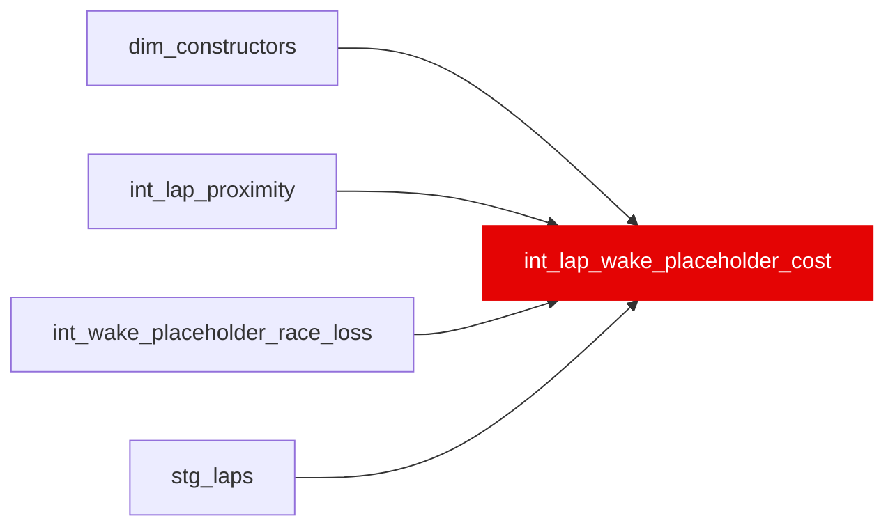

{/* _AUTOGENERATED   do not hand-edit. Run `python scripts/gen_dbt_reference.py` to regenerate. */}

<Note>Part of the [Physics](/transform/families/physics) family.</Note>

WC-11 INTERIM PLACEHOLDER: one row per lap, an ASSUMED wake (dirty-air) cost in seconds for the cost display only. loss_s_per_lap_within_1s is set per race by int_wake_placeholder_race_loss (WC-12: an assumed rule from the layout's corner mix and a regulation-era factor, with the circuit-class values of seeds/wake_placeholder_values.csv as the flagged fallback; assumptions, not measurements); it is multiplied by the lap's MEASURED exposure (share of the lap within 1 s of the car ahead, plus half the share between 1 and 2 s, from int_lap_proximity's crossing-time gaps). WC-13: the race value is multiplied per lap by an assumed tyre factor and a car factor (neutral 1.00 for every team), bounded and flagged. WC-16: the tyre factor is set by the lap's Pirelli C-number relative to the race's medium (seeds/wake_placeholder_tyre_allocation.csv x seeds/wake_placeholder_c_number_factor.csv) for 2019-2025, and by the relative dry class (seeds/wake_placeholder_compound_factor.csv) for 2018 or a race with no C-number trio (compound_factor_scale). Every value is labelled modelled / placeholder and carries the DD-WC2 disclaimer word for word plus a placeholder line; an unavailable lap is NULL with a reason, never 0. NOT an ML feature or target and not read by the label spine; dirty_air_tax_s is unchanged. Replace the seed's numbers with calibrated values later and nothing downstream changes. See _roadmap/_wake-calibration/wi/WC-11-interim-placeholder-values.md.

## Lineage

## Overview

| Property | Value |
|---|---|
| Layer | `intermediate` |
| Family | [Physics](/transform/families/physics) |
| Contract enforced | No |
| Tags | `wake_placeholder` |
| Upstream | [`int_wake_placeholder_race_loss`](./int_wake_placeholder_race_loss), [`int_lap_proximity`](./int_lap_proximity), [`stg_laps`](../stg/stg_laps), [`dim_constructors`](../dim/dim_constructors) |

**44 tests** [guard](/transform/ci/overview) this model  -  41 generic, 3 singular.

## Columns

| Column | Type | Nullable | Tests | Description |
|---|---|---|---|---|
| `lap_id` |   | Yes | [`not_null`](/transform/ci/structural), [`unique`](/transform/ci/structural) | PK, FK to stg_laps |
| `corner_class` |   | Yes | [`not_null`](/transform/ci/structural), [`accepted_values`](/transform/ci/range-and-domain) | Circuit wake class from the seed (fast / medium / slow). |
| `class_source` |   | Yes | [`not_null`](/transform/ci/structural), [`accepted_values`](/transform/ci/range-and-domain) | circuit_entry, circuit_entry_override (per-circuit loss in the seed) or unlisted_circuit_default. |
| `era` |   | Yes | [`not_null`](/transform/ci/structural) | WC-12 regulation era of the season (seeds/wake_placeholder_rule.csv). |
| `era_factor` |   | Yes | [`not_null`](/transform/ci/structural) | WC-12 assumed era multiplier (2017-18 = 1.00). |
| `loss_source` |   | Yes | [`not_null`](/transform/ci/structural), [`accepted_values`](/transform/ci/range-and-domain) | WC-12 race_structure (the rule) or class_fallback (no corner structure for the race; flagged). |
| `loss_bounded` |   | Yes | [`not_null`](/transform/ci/structural) | WC-12 true when the rule's raw value was held to the seed's min/max bounds. |
| `loss_basis` |   | Yes | [`not_null`](/transform/ci/structural) | WC-12 one-line, human-readable statement of how this race's assumed loss was set. |
| `loss_s_per_lap_within_1s` |   | Yes | [`not_null`](/transform/ci/structural), [`accepted_range`](/transform/ci/range-and-domain) | Assumed loss for a full lap within 1 s of the car ahead (placeholder, s), PER LAP since WC-13: race_loss_s_per_lap_within_1s x compound_factor x constructor_factor, held to the rule's 0.15-0.55 s bounds (lap_loss_bounded) and rounded to 4 dp. |
| `race_loss_s_per_lap_within_1s` |   | Yes | [`not_null`](/transform/ci/structural), [`accepted_range`](/transform/ci/range-and-domain) | WC-13 the race's assumed loss before the tyre and car factors (int_wake_placeholder_race_loss). Calibrated per-race values slot in here. |
| `compound` |   | Yes |   | WC-13 FastF1 compound name on the lap (stg_laps; absolute legacy names in 2018). NULL when not recorded. |
| `compound_class` |   | Yes | [`accepted_values`](/transform/ci/range-and-domain) | WC-13 the lap's relative dry class in its race (SOFT / MEDIUM / HARD), or INTERMEDIATE / WET. 2018 laps are ranked within the race's three dry compounds. NULL when missing or unresolved. |
| `compound_factor` |   | Yes | [`not_null`](/transform/ci/structural), [`accepted_range`](/transform/ci/range-and-domain) | Assumed tyre multiplier. WC-16, c_number scale: ROUND(clamp(step x medium shift, 0.90, 1.17), 4) from seeds/wake_placeholder_c_number_factor.csv (step by C-number distance from the race medium; medium shift 1.00 for every medium since DD-WC29); relative_class scale (2018, or no trio): the WC-13 relative factor (seeds/wake_placeholder_compound_factor.csv); neutral 1.00 when wet, intermediate, missing or unresolved (flagged as before). |
| `compound_factor_source` |   | Yes | [`not_null`](/transform/ci/structural), [`accepted_values`](/transform/ci/range-and-domain) |  |
| `compound_basis` |   | Yes |   | Why the tyre factor has its value: WC-16 one line naming the lap's C-number, its distance from the race medium and the two constants (c_number scale), or the relative seed's basis. NULL when the compound is missing or unresolved. |
| `compound_factor_scale` |   | Yes | [`not_null`](/transform/ci/structural), [`accepted_values`](/transform/ci/range-and-domain) | WC-16 which scale set the tyre factor: c_number (2019-2025 dry lap, verified race trio), relative_class (2018 named compounds, or a race with no trio), neutral (wet, intermediate, missing or unresolved compound). |
| `tyre_c_number` |   | Yes | [`accepted_values`](/transform/ci/range-and-domain) | WC-16 the lap's Pirelli C-number (C1-C6) from the race's verified trio; NULL unless compound_factor_scale = c_number. |
| `race_medium_c` |   | Yes |   | WC-16 the race's MEDIUM C-number (2019 on); NULL in 2018. |
| `constructor_id` |   | Yes |   | WC-13 stg_laps.constructor_id (FastF1 team name, the key the ML side uses). |
| `constructor_lineage_id` |   | Yes |   | WC-13 dim_constructors lineage (groups a team's renames). |
| `constructor_factor` |   | Yes | [`not_null`](/transform/ci/structural), [`accepted_range`](/transform/ci/range-and-domain) | WC-13 per-(season, constructor) car multiplier; neutral 1.00 for every team today (no per-team claim). |
| `constructor_factor_source` |   | Yes | [`not_null`](/transform/ci/structural), [`accepted_values`](/transform/ci/range-and-domain) |  |
| `constructor_basis` |   | Yes | [`not_null`](/transform/ci/structural) |  |
| `lap_loss_bounded` |   | Yes | [`not_null`](/transform/ci/structural) | WC-13 true when race value x tyre x car fell outside 0.15-0.55 s and was held to the bound. |
| `factor_flag` |   | Yes |   | WC-13 NULL when both factors resolved; otherwise which factor fell back to the neutral 1.00 and why. |
| `lap_loss_basis` |   | Yes | [`not_null`](/transform/ci/structural) | WC-13 one line stating race value x tyre x car for this lap. |
| `wake_exposure` |   | Yes | [`accepted_range`](/transform/ci/range-and-domain) | Measured exposure 0..1 (see model description). NULL when the lap is unavailable. |
| `wake_cost_placeholder_s` |   | Yes | [`not_null`](/transform/ci/structural) | Placeholder cost in seconds = loss_s_per_lap_within_1s (per lap, WC-13) x wake_exposure. Modelled, not measured. NULL (shown as "—" with unavailable_reason) when the lap is unavailable; 0.0 only for a measured lap with no car within 2 s. |
| `value_label` |   | Yes | [`not_null`](/transform/ci/structural), [`accepted_values`](/transform/ci/range-and-domain) |  |
| `value_kind` |   | Yes | [`not_null`](/transform/ci/structural), [`accepted_values`](/transform/ci/range-and-domain) |  |
| `unavailable_reason` |   | Yes |   | Why the lap has no value (no gap measured; neutralised lap; no circuit value). NULL when the lap has a value. |
| `disclaimer` |   | Yes | [`not_null`](/transform/ci/structural), [`accepted_values`](/transform/ci/range-and-domain) | The DD-WC2 disclaimer, word for word (reworded by the owner 2026-10-31). Written with a doubled quote here because accepted_values pastes the value into SQL unescaped. |
| `disclaimer_placeholder` |   | Yes | [`not_null`](/transform/ci/structural), [`accepted_values`](/transform/ci/range-and-domain) | The placeholder line (owner ruling 2026-10-30, kept beside DD-WC2), word for word. |
