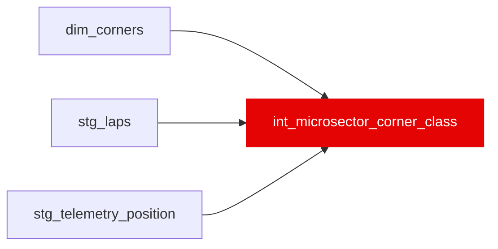

{/* _AUTOGENERATED   do not hand-edit. Run `python scripts/gen_dbt_reference.py` to regenerate. */}

<Note>Part of the [Physics](/transform/families/physics) family.</Note>

DA-02P. The micro-sector to corner-class map for the DA-03 P3 mechanism placebo. One row per (race, micro-sector). Micro-sector m spans [m, m + 1) * lap_length_m / var('microsector_n'), lap_length_m the race median of distance_m / relative_distance. Each dim_corners apex gets an apex speed (median over green racing laps of the minimum position-channel speed within 50 m of the apex) and a class: low &lt; 120 km/h, medium 120 to &lt; 200, high 200 to &lt; 280, flat &gt;= 280 (flat-out kinks, split out of high by owner decision D5 / DD10 and reported apart from the fast-corner test). corner_class is that class when every apex inside the micro-sector shares it, mixed when they differ (a micro-sector with a high and a flat apex is mixed), straight when there is no apex inside and none within 100 m before its start or 150 m after its end, link otherwise. Built from geometry and speed only; it reads no gap or time loss. Thresholds are registered in the DA-03 pre-registration amendment (DA-02P).

## Lineage

## Overview

| Property | Value |
|---|---|
| Layer | `intermediate` |
| Family | [Physics](/transform/families/physics) |
| Contract enforced | No |
| Tags | `dirty_air_dynamic` |
| Upstream | [`stg_laps`](../stg/stg_laps), [`stg_telemetry_position`](../stg/stg_telemetry_position), [`dim_corners`](../dim/dim_corners) |
| Model-level tests | `unique_combination_of_columns` |

**12 tests** [guard](/transform/ci/overview) this model  -  10 generic, 2 singular.

## Columns

| Column | Type | Nullable | Tests | Description |
|---|---|---|---|---|
| `race_microsector_id` |   | Yes | [`not_null`](/transform/ci/structural), [`unique`](/transform/ci/structural) |  |
| `race_id` |   | Yes | [`not_null`](/transform/ci/structural) |  |
| `microsector` |   | Yes | [`not_null`](/transform/ci/structural), [`accepted_range`](/transform/ci/range-and-domain) |  |
| `lap_length_m` |   | Yes | [`not_null`](/transform/ci/structural), [`accepted_range`](/transform/ci/range-and-domain) |  |
| `corner_class` |   | Yes | [`not_null`](/transform/ci/structural), [`accepted_values`](/transform/ci/range-and-domain) |  |
