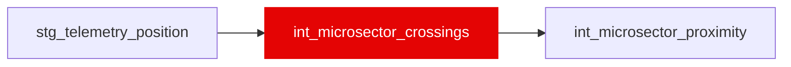

{/* _AUTOGENERATED   do not hand-edit. Run `python scripts/gen_dbt_reference.py` to regenerate. */}

<Note>Part of the [Physics](/transform/families/physics) family.</Note>

DA-02. The session clock at which each driver reaches each of var('microsector_n') (20) fixed track positions per lap, linearly interpolated between the two position samples that straddle the boundary (DA-01 validated the interpolation against the timing feed's sector lines, median absolute error 0.053-0.078 s). One row per (race, driver, lap, boundary); boundary 0 of lap L + 1 is the lap line. bracket_s is the width of the straddling pair; on_track is TRUE when both samples are OnTrack. No label reads it. _roadmap/_dirty-air.

## Lineage

## Overview

| Property | Value |
|---|---|
| Layer | `intermediate` |
| Family | [Physics](/transform/families/physics) |
| Contract enforced | No |
| Tags | `dirty_air_dynamic` |
| Upstream | [`stg_telemetry_position`](../stg/stg_telemetry_position) |
| Model-level tests | `unique_combination_of_columns` |

**9 tests** [guard](/transform/ci/overview) this model  -  7 generic, 2 singular.

## Columns

| Column | Type | Nullable | Tests | Description |
|---|---|---|---|---|
| `crossing_time_s` |   | Yes | [`not_null`](/transform/ci/structural) |  |
| `microsector` |   | Yes | [`not_null`](/transform/ci/structural), [`accepted_range`](/transform/ci/range-and-domain) |  |
| `bracket_s` |   | Yes | [`not_null`](/transform/ci/structural), [`accepted_range`](/transform/ci/range-and-domain) |  |
| `drs_state` |   | Yes | [`accepted_values`](/transform/ci/range-and-domain) | DA-02P. DRS state of the last position sample before the boundary (stg_telemetry_position.drs_state). Carried, never used to drop or order a crossing. |
