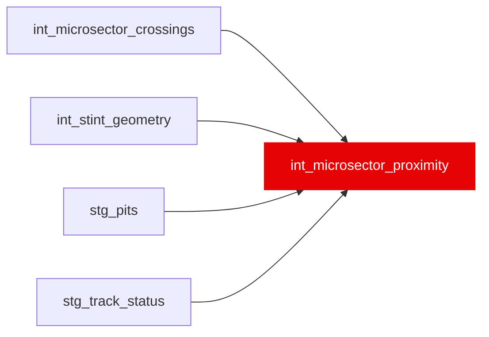

{/* _AUTOGENERATED   do not hand-edit. Run `python scripts/gen_dbt_reference.py` to regenerate. */}

<Note>Part of the [Physics](/transform/families/physics) family.</Note>

DA-02. The micro-sector panel the dirty-air identification (DA-03, W11 option C) is fitted on. One row per (race, driver, lap, micro-sector): time_s (the interpolated time to drive it), y_s (time_s minus the median of the timing-valid cars on the same race, lap and micro-sector; positive = slower), the entry gap to the car ahead (gap_ahead_s, from crossing order so lapped cars are handled), the gap behind, the exit gap (an outcome, for the lead window only), the car ahead's own y_s, and one invalid_reason (NULL = valid). Unknown car ahead is NULL, never 0. A lapped car ahead within var('microsector_lapped_ahead_window_s') invalidates the row (DD5); beyond it the row is in the reference band. gap_band is the design note's step function with &gt;3 s as the reference. No label, ML mart or isolation model reads it. Design: _roadmap/_dirty-air/wi/DA-design-note.md, DA-02-tables.md.

## Lineage

## Overview

| Property | Value |
|---|---|
| Layer | `intermediate` |
| Family | [Physics](/transform/families/physics) |
| Contract enforced | No |
| Tags | `dirty_air_dynamic` |
| Upstream | [`int_microsector_crossings`](./int_microsector_crossings), [`stg_track_status`](../stg/stg_track_status), [`stg_pits`](../stg/stg_pits), [`int_stint_geometry`](./int_stint_geometry) |
| Model-level tests | `unique_combination_of_columns` |

**19 tests** [guard](/transform/ci/overview) this model  -  14 generic, 5 singular.

## Columns

| Column | Type | Nullable | Tests | Description |
|---|---|---|---|---|
| `microsector_id` |   | Yes | [`not_null`](/transform/ci/structural), [`unique`](/transform/ci/structural) |  |
| `lap_id` |   | Yes | [`not_null`](/transform/ci/structural), `relationships` | stg_laps.lap_id of the lap the micro-sector belongs to. |
| `race_id` |   | Yes | [`not_null`](/transform/ci/structural) |  |
| `driver_id` |   | Yes | [`not_null`](/transform/ci/structural) |  |
| `microsector` |   | Yes | [`not_null`](/transform/ci/structural) |  |
| `entry_time_s` |   | Yes | [`not_null`](/transform/ci/structural) |  |
| `timing_invalid_reason` |   | Yes | [`accepted_values`](/transform/ci/range-and-domain) | Why time_s is NULL: lap1, pit_lane, no_next_crossing, off_track, wide_bracket, non_green_flag or post_restart; NULL when the row has a usable time. |
| `invalid_reason` |   | Yes | [`accepted_values`](/transform/ci/range-and-domain) | timing_invalid_reason, or car_ahead_unknown, or lapped_ahead_within_window; NULL = valid (priced). |
| `gap_band` |   | Yes | [`accepted_values`](/transform/ci/range-and-domain) |  |
| `drs_state_entry` |   | Yes | [`accepted_values`](/transform/ci/range-and-domain) | DA-02P. DRS state at the entry boundary (int_microsector_crossings.drs_state): off, eligible (FastF1 code 8, within 1 s at the detection line), open (10/12/14), unknown, or NULL. Carried only; not a control in the main DA-03 spec. |
| `drs_state_exit` |   | Yes | [`accepted_values`](/transform/ci/range-and-domain) | DA-02P. DRS state at the exit boundary (the next boundary's entry state); NULL when there is no next crossing. |
| `drs_open` |   | Yes |   | DA-02P. TRUE when DRS is open at entry or exit, FALSE when both are off or eligible, NULL otherwise. The registered DRS spec drops rows where drs_open is not FALSE. |
