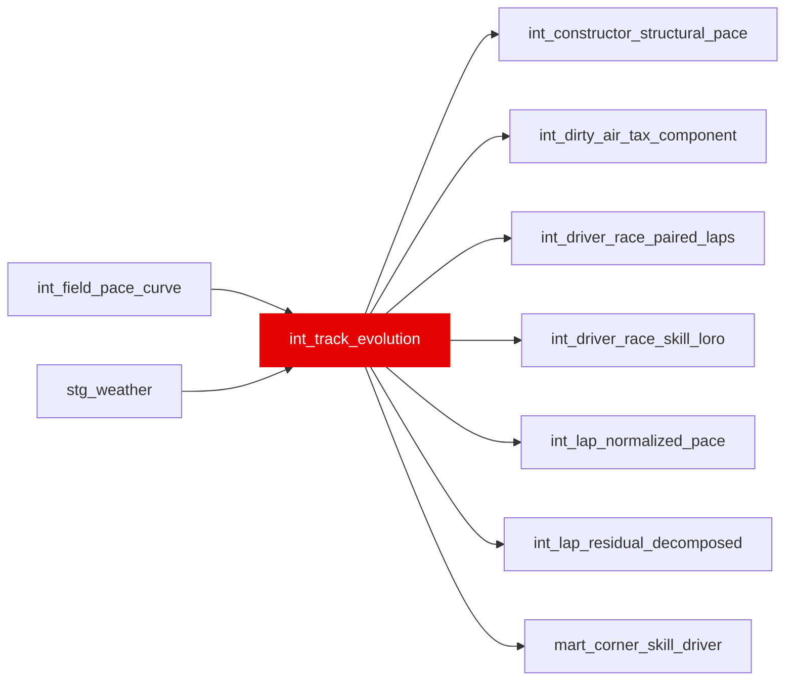

{/* _AUTOGENERATED   do not hand-edit. Run `python scripts/gen_dbt_reference.py` to regenerate. */}

<Note>Part of the [Pace Baselines](/transform/families/pace-baselines) family.</Note>

Track evolution over a race: a linear pace trend and a track-temperature ambient component, both split out of the field pace base. Grain is (race_year, race_id, lap_number), one row per lap that has a non-thin field-pace cell. The pace trend (rubber_component_s) is one straight-line fit of field pace on lap number per race with its slope capped at zero; it is often read as rubber build but also absorbs anything else that moves field pace steadily. The ambient component is fitted on track temperature only (humidity is carried but not fitted) and is 0.0 where the race has no usable temperature fit. rainfall_flag and rain_state are carried from int_lap_rain_state.

## Lineage

## Overview

| Property | Value |
|---|---|
| Layer | `intermediate` |
| Family | [Pace Baselines](/transform/families/pace-baselines) |
| Contract enforced | No |
| Upstream | [`int_field_pace_curve`](./int_field_pace_curve), [`stg_weather`](../stg/stg_weather) |
| Model-level tests | `unique_combination_of_columns` |

**7 tests** [guard](/transform/ci/overview) this model  -  5 generic, 2 singular.

## Columns

| Column | Type | Nullable | Tests | Description |
|---|---|---|---|---|
| `race_year` |   | Yes | [`not_null`](/transform/ci/structural) | Race year |
| `race_id` |   | Yes | [`not_null`](/transform/ci/structural), `relationships` | Race identifier |
| `lap_number` |   | Yes | [`not_null`](/transform/ci/structural) | Lap number within race |
