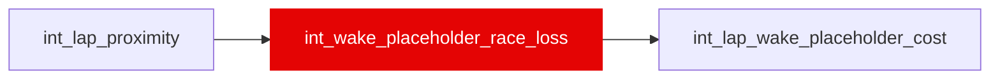

{/* _AUTOGENERATED   do not hand-edit. Run `python scripts/gen_dbt_reference.py` to regenerate. */}

<Note>Part of the [Physics](/transform/families/physics) family.</Note>

WC-12: one row per race (every race in race_to_track or int_lap_proximity), the ASSUMED loss in seconds for a full lap within 1 s of the car ahead, read by int_lap_wake_placeholder_cost. A transparent rule, not a fit: corner_index (fast-corner equivalents from the layout's corner mix, seeds/wake_placeholder_race_structure.csv) x an era factor x a reference scale, clamped and rounded; constants and their reasons in seeds/wake_placeholder_rule.csv. No lap time, segment time or speed is read. A race with no corner structure falls back to era_factor x the circuit-class value and is flagged loss_source = class_fallback. Display only: never an ML feature or target. See _roadmap/_wake-calibration/wi/WC-11-interim-placeholder-values.md (WC-12 section).

## Lineage

## Overview

| Property | Value |
|---|---|
| Layer | `intermediate` |
| Family | [Physics](/transform/families/physics) |
| Contract enforced | No |
| Tags | `wake_placeholder` |
| Upstream | [`int_lap_proximity`](./int_lap_proximity) |

**16 tests** [guard](/transform/ci/overview) this model  -  15 generic, 1 singular.

## Columns

| Column | Type | Nullable | Tests | Description |
|---|---|---|---|---|
| `race_id` |   | Yes | [`not_null`](/transform/ci/structural), [`unique`](/transform/ci/structural) |  |
| `race_year` |   | Yes | [`not_null`](/transform/ci/structural) |  |
| `era` |   | Yes | [`not_null`](/transform/ci/structural) |  |
| `era_factor` |   | Yes | [`not_null`](/transform/ci/structural), [`accepted_range`](/transform/ci/range-and-domain) |  |
| `loss_source` |   | Yes | [`not_null`](/transform/ci/structural), [`accepted_values`](/transform/ci/range-and-domain) |  |
| `corner_index` |   | Yes | [`not_null`](/transform/ci/structural) | Fast-corner equivalents on the layout; NULL on a class_fallback race. |
| `loss_s_per_lap_within_1s` |   | Yes | [`not_null`](/transform/ci/structural), [`accepted_range`](/transform/ci/range-and-domain) |  |
| `loss_bounded` |   | Yes | [`not_null`](/transform/ci/structural) |  |
| `loss_basis` |   | Yes | [`not_null`](/transform/ci/structural) |  |
| `value_kind` |   | Yes | [`not_null`](/transform/ci/structural), [`accepted_values`](/transform/ci/range-and-domain) |  |
